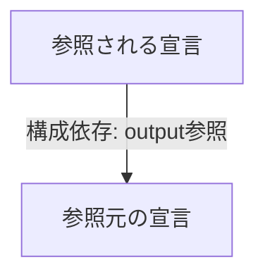

# Terraform to Mermaid

対象HCLに記述された構成と依存関係を、読み手の目的に合うMermaid図へまとめる。
HCLの宣言と、実環境の配備・通信実績を区別する。

判断と固定条件: 図の粒度、配置、グルーピングは目的に合わせる。ノード・エッジの根拠、対象範囲、既存文書の保持は固定する。

## 対象を読む

依頼されたmodule・environment・rootを特定する。`main.tf`だけに限定せず、そのmoduleを構成するHCLを読む。
ファイル名・moduleのsource・参照から必要な範囲へ進み、vendor/cacheや別environmentを無条件に混ぜない。
remote moduleの中身がない場合は境界として表し、実装を推測しない。

通常はmodule単位で全体を表す。障害調査、権限、通信経路等が目的なら、判断に必要なresourceやIAMまで展開する。
既存図を更新する場合はその粒度・記法を継承し、今回の変更と無関係な再構成をしない。

## ノードとエッジ

- `module`、`resource`、`data`、外部入力等の実宣言を根拠にノードを置く。
- 式の参照と `depends_on` から依存を取り、必要に応じてvariables、locals、outputsを辿る。
- 凡例に向きを記す。依存先から参照元へ描く場合も、実通信の方向と混同しない。
- バケットやtopicの名前だけでデータフローを発明しない。参照が証明するのはまず構成依存であり、通信方向・権限は別の記述で確かめる。
- IAM、暗号化、外部サービスを省略するなら図の目的に照らして決める。権限や信頼境界を説明する図では省略しない。
- unresolvedな条件式・変数・remote sourceは不明な範囲を示す。HCLだけを読んで配備済みと書かない。

図の説明または対応表に、主要なノード・エッジの根拠ファイル/宣言を残す。
秘密値やstateの機微情報を図へ転記しない。

## 描画

通常は `flowchart TB` を使い、横方向の流れを読む図では `LR` に切り替える。
ノード数で機械的に分割せず、moduleや責務、環境等の実境界でsubgraphを作る。
ラベルには意味を示し、色やemojiだけで区別しない。

GCPの既存配色・形状を踏襲する場合は [references/gcp-icons.md](references/gcp-icons.md) を使う。
AWS等で対応表がない場合は標準のノードと明示的なlabelを使える。即興のアイコン体系を作る必要はない。

これは向きとラベルの例。実図の宣言名と根拠に置き換える。
Mermaidのlabelを適切にquote・escapeし、実際のrendererが対応する記法を使う。

## 出力と確認

指定がなければ `docs/infrastructure.md` にMermaidコードブロックを含む文書を保存する。
既存文書の内容・所有範囲を先に確認し、無関係な内容を上書きしない。

既存のrendererやpreview手段で描画を確認する。未導入の外部コードを一回限りランチャーで取得しない。
rendererが使えなければノード・エッジとHCLの照合、構文の確認を行い、表示は未検証と明記する。
完了時は成果物、対象HCLの範囲、宣言との照合結果、表示確認、残る不明点を返す。
